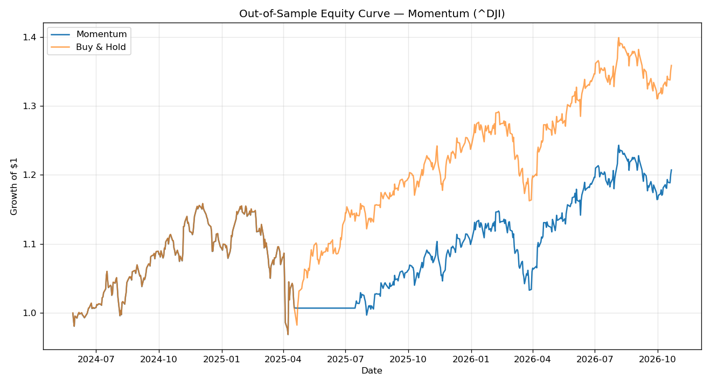
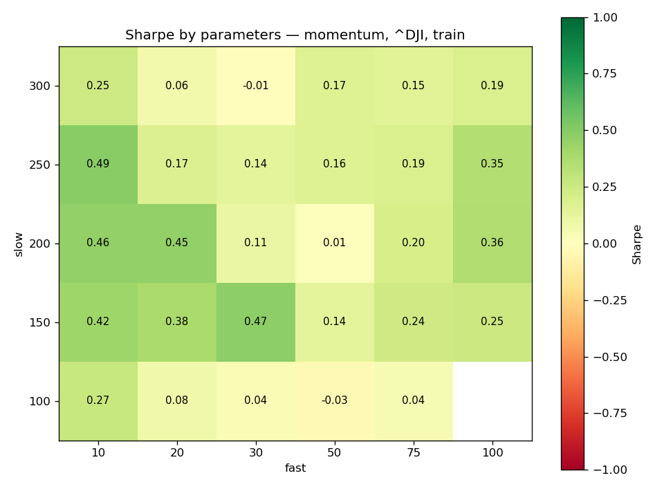

# Quantitative Trading Strategy Backtester

A from-scratch backtesting framework in Python for evaluating systematic
trading strategies on real market data. Built to apply data-science
rigor to trading: **the goal is not to find a profitable strategy, but
to test ideas honestly and avoid fooling yourself.**

This repository implements three classic strategies — **mean-reversion**,
**momentum (moving-average crossover)** and **breakout (Donchian
channel)** — and evaluates them against a buy-and-hold benchmark using
out-of-sample testing, walk-forward periods, several assets and
bootstrap confidence intervals.

The full analysis, with commentary, is in
[`notebooks/strategy_research.ipynb`](notebooks/strategy_research.ipynb).

---

## Why this project

Most retail backtests look impressive and are quietly broken: they peek
at future data, ignore trading costs, and never compare against simply
holding the asset. This project deliberately does the opposite and
treats a trading strategy like any other ML model — train/test split,
honest metrics, and a benchmark.

## Methodology (the part that matters)

Every strategy is evaluated under the same disciplined rules:

- **No look-ahead bias** — signals are shifted by one bar, so a decision
  made today is only acted on tomorrow.
- **Transaction costs** — a configurable cost (in basis points) is
  charged on every position change.
- **Train / test split** — strategies are judged on out-of-sample data
  the logic has never seen. In-sample numbers are treated as unreliable.
- **Benchmark comparison** — every result is compared to buy-and-hold.
  A strategy that cannot beat holding the asset has no value.
- **Standard metrics** — Total and Annualized Return, Volatility,
  Sharpe, Sortino, Calmar and Maximum Drawdown, plus trade statistics
  and alpha/beta/information ratio against buy & hold.
- **Uncertainty** — a block-bootstrap 95% interval for every Sharpe
  ratio, because ~600 test days cannot pin it down precisely.
- **Robustness** — results across walk-forward periods, five assets,
  transaction-cost levels and parameter grids, not one lucky setting.

## Strategies

| Strategy | Logic | Works best in |
|---|---|---|
| Mean-Reversion | Buy when price is unusually far below its average (z-score) | Range-bound / choppy markets |
| Momentum | Buy when a fast moving average is above a slow one (optionally short below) | Trending markets |
| Breakout | Buy on a new 55-day high, sell on a new 20-day low | Trending markets, fast exits |

Any strategy can be combined with **volatility targeting**
(`--vol-target 0.10`), which scales the position so the strategy aims
for a constant volatility instead of being all-in or all-out.

## Results (Dow Jones, ^DJI, out-of-sample)

All strategies were tested on 8 years of daily Dow Jones data
(2018-10-22 to 2026-10-21). The first 70% is the training period; the
numbers below are for the out-of-sample test period
(2024-05-28 to 2026-10-21), with 2 bps transaction costs:

| Metric | Mean-Reversion | Momentum | Breakout | Buy & Hold |
|---|---|---|---|---|
| Total Return | -13.4% | +20.7% | +0.1% | +35.9% |
| Annualized Return | -5.8% | +8.2% | +0.0% | +13.7% |
| Annualized Volatility | 13.2% | 13.7% | 8.5% | 14.5% |
| Sharpe | -0.39 | +0.64 | +0.05 | +0.96 |
| Sharpe, bootstrap 95% interval | [-1.26, 0.41] | [-0.39, 1.84] | [-1.04, 1.19] | |
| Sortino | -0.57 | +0.95 | +0.07 | +1.43 |
| Max Drawdown | -20.5% | -16.4% | -9.5% | -16.4% |
| Trades (per year) | 33 (13.8) | 2 (0.8) | 9 (3.8) | |
| Time in market | 86% | 90% | 56% | 100% |
| Beta / correlation to index | 0.16 / 0.17 | 0.90 / 0.95 | 0.34 / 0.59 | |
| Alpha (annualized) | -7.3% | -3.6% | -4.4% | |



The chart shows the typical cost of trend-following: momentum tracks
the market, steps aside after the April 2025 sell-off, and then misses
most of the rebound because the 50/200 crossover only turns positive
again in August. Lower risk in the crash, but a permanent gap in return.
The mean-reversion chart is in
[`docs/equity_curve_mean_reversion.png`](docs/equity_curve_mean_reversion.png).

Walk-forward check (`--walk-forward 5`, five consecutive ~16-month
periods): momentum and mean-reversion each beat buy & hold on Sharpe in
1 of 5 periods (the same one, the 2021-22 decline, by losing less), and
breakout in none.

Re-tuning inside each walk-forward training window (`--walk-forward 5
--optimize`: every period uses the parameter set with the best Sharpe on
all earlier data, from a small grid) gives a mixed picture. For momentum
the average Sharpe over the five periods stays the same (0.29 with
re-tuning and with the default 50/200). For mean-reversion it rises from
-0.34 to +0.45, but almost all of that gain comes from a single period
(2021-22, Sharpe 1.80), so it is weak evidence, not a discovery.

Multi-asset check (`python compare_assets.py`, out-of-sample Sharpe,
same parameters everywhere):

| Asset | Mean-Reversion | Momentum | Breakout | Buy & Hold |
|---|---|---|---|---|
| ^DJI (Dow Jones) | -0.39 | 0.64 | 0.05 | 0.96 |
| SPY (S&P 500) | 0.22 | 0.75 | 0.72 | 1.14 |
| QQQ (Nasdaq 100) | -0.01 | 0.75 | 0.60 | 1.02 |
| IWM (Russell 2000) | -0.13 | 0.72 | 0.23 | 0.76 |
| GLD (Gold) | -0.31 | 1.13 | 0.76 | 1.12 |

Further checks on the Dow (details in the notebook):

- **Parameters** (`python sensitivity.py`): momentum's training Sharpe is
  positive in 27 of 29 fast/slow combinations, so its result does not
  hinge on one lucky setting.

  

- **Costs** (`--cost-sweep`): momentum is unaffected up to 20 bps;
  breakout turns negative between 5 and 10 bps; mean-reversion is
  negative even at zero cost.
- **Volatility targeting** (`--vol-target 0.10`): cuts momentum's max
  drawdown from -16.4% to -12.3% at a near-identical Sharpe (0.62).
- **Short selling** (`--allow-short`): makes momentum clearly worse
  (Sharpe 0.26, drawdown -24.5%), as expected on an index that drifts up.

**Key findings:**

- Momentum outperformed mean-reversion on the trending Dow, confirming
  the regime hypothesis: a trend-following rule fits a trending market,
  while mean-reversion is structurally the wrong tool for it.
- No strategy beat buy-and-hold — a realistic, well-documented outcome.
  Beating the market is hard, and most simple rules don't.
- Even momentum's positive Sharpe is not statistically distinguishable
  from zero (bootstrap interval [-0.39, 1.84]). With beta 0.90 and 95%
  correlation it behaves like a de-risked index position, not a source
  of alpha.
- The pattern holds across assets: momentum has a positive Sharpe on
  all five, mean-reversion on only one, and only momentum on gold
  roughly ties buy & hold (1.13 vs 1.12).
- Mean-reversion lost money in all 5 walk-forward periods and is worse
  than buy & hold with ~99% bootstrap probability, so its poor result is
  not an accident of where the train/test cut falls.
- Fixing a warm-up bug (see below) raised momentum's out-of-sample
  return from +13.0% to +20.7%: the earlier version had been forced to
  sit flat for the first 200 days of the test period.

Documenting strategies that *don't* beat the benchmark, and explaining
*why*, is the point: this is a research process, not a sales pitch.

### Bugs found while reviewing the backtest

Honest backtests need their own code reviewed. Issues fixed so far:

- **Indicator warm-up in the test period.** Signals were recomputed on
  the test slice alone, so a 200-day moving average had no value for the
  first 200 test days. Signals are now computed on the full history
  (still leak-free: rolling windows only look backwards) and then split.
- **Non-standard Sharpe ratio.** It divided the geometric annual return
  by volatility; it now uses the standard mean/std of daily (excess)
  returns × √252.
- **Silent synthetic data.** A failed (often rate-limited) download used
  to swap in random data with one easily-missed line of output. It now
  warns loudly, labels the chart, and can be turned off with
  `--no-fallback`.
- **Free first trade.** A period that started already invested was not
  charged the entry cost.
- **Sharpe of 7×10¹⁶.** Float noise made the volatility of a constant
  return series ~1e-19 instead of 0 (caught by a unit test).
- **Cache depended on the working directory**, so running from another
  folder re-downloaded and, when rate-limited, fell back to synthetic
  data (caught by the notebook's real-data check).
- **Importing the plotting module disabled Jupyter inline plots** by
  forcing matplotlib's Agg backend.

## Project structure

```
backtester/
  data.py        price loading (yfinance + daily cache, synthetic fallback)
  strategies.py  mean-reversion, momentum and breakout signal generators
  sizing.py      volatility-targeted position sizing
  engine.py      vectorized backtest, train/test split, walk-forward (+ re-tuning)
  metrics.py     performance, trade and benchmark-relative statistics
  analysis.py    bootstrap intervals, cost sweep, parameter sensitivity
  results.py     JSON/CSV export of a run
  plotting.py    equity and drawdown charts
  cli.py         command-line options and config files shared by all scripts
tests/           pytest suite, 99% coverage (incl. automated look-ahead-bias tests)
notebooks/       research notebook with the full analysis
configs/         example TOML run configurations
mean_reversion_backtest.py
momentum_backtest.py
breakout_backtest.py
compare_assets.py   runs all strategies on several assets
sensitivity.py      Sharpe heatmap over a parameter grid
```

## Tech stack

Python, pandas, NumPy, Matplotlib, yfinance; pytest (+ coverage), ruff,
mypy and pre-commit for quality checks; GitHub Actions for CI.

## How to run

```bash
pip install -r requirements.txt
python mean_reversion_backtest.py
python momentum_backtest.py
python breakout_backtest.py
```

By default the scripts pull real daily data via `yfinance` and cache it
in `.cache/` for the day. If the download fails, they fall back to
synthetic data with a clear warning so the code always runs; pass
`--no-fallback` to fail instead.

Every setting is a command-line option (`--help` lists them all):

```bash
python momentum_backtest.py --ticker SPY --years 15 --fast 20 --slow 100
python mean_reversion_backtest.py --ticker QQQ --entry-z 1.5 --cost-bps 5
python momentum_backtest.py --walk-forward 5
python mean_reversion_backtest.py --walk-forward 5 --optimize
python momentum_backtest.py --vol-target 0.10 --cost-sweep
python momentum_backtest.py --save-results results/   # JSON summary + daily CSV
python compare_assets.py --tickers SPY QQQ GLD
python sensitivity.py --strategy mean_reversion
```

Options can also come from a TOML file; command-line flags still win:

```bash
python momentum_backtest.py --config configs/momentum_spy.toml
```

To open the notebook: `pip install ".[notebook]"` and `jupyter lab`.

## Development

```bash
pip install -r requirements-dev.txt
pre-commit install      # run all checks below on every commit
pytest --cov            # tests + coverage (CI requires >= 90%)
ruff check .
mypy
```

## What I learned

- How to build a leak-free backtest and why look-ahead bias silently
  ruins most amateur results.
- Why a strategy must be matched to the market regime (mean-reversion vs
  trend).
- How to read risk-adjusted performance (Sharpe, drawdown) rather than
  raw return.
- That a positive Sharpe on a few hundred days can easily be noise, and
  how to quantify that with a block bootstrap.
- That rigorous evaluation — not clever ideas — is what separates
  systematic trading from gambling.

## Roadmap

- [ ] Replace the hand-coded z-score rule with an ML classifier
      (feature engineering from price/volatility, proper CV).
- [x] Multi-asset testing to check robustness.
- [x] Walk-forward validation across several periods.
- [x] Parameter optimisation inside each walk-forward training window.
- [x] Volatility-targeted position sizing instead of all-in / all-out.
- [ ] Portfolio-level backtest: trade several assets at once with a
      shared capital budget.

## Disclaimer

This is an educational and portfolio project. It is **not** financial
advice and nothing here is a recommendation to trade.
